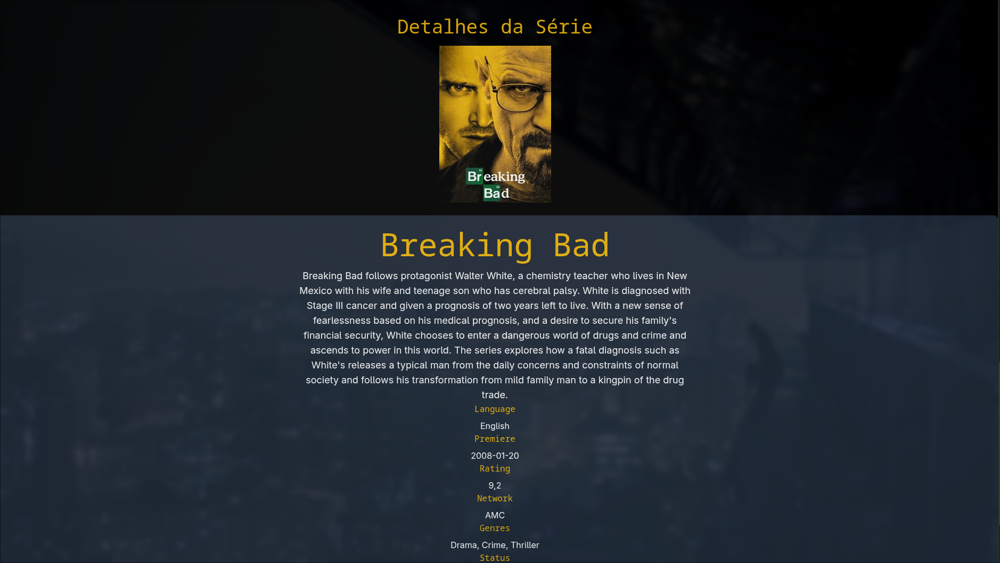

# Catálogo de Séries

Aplicação web para consulta e exploração de informações sobre séries de televisão, desenvolvida como trabalho acadêmico da disciplina de Programação Web. O sistema consome a API pública TVmaze e permite pesquisar séries por nome, visualizar resultados em cards, consultar detalhes completos e filtrar por gênero e status.

---



## Descrição

O **Catálogo de Séries** é uma Single Page Application (SPA) client-side que oferece uma interface intuitiva para descobrir e explorar séries de TV. A aplicação realiza buscas em tempo real na API do TVmaze, exibe os resultados em uma grade responsiva e permite ao usuário acessar informações detalhadas de cada série, incluindo resumo, elenco, rede de exibição, avaliação e status.

---

## Funcionalidades

- **Pesquisa de séries**: Busca por nome utilizando o endpoint de pesquisa da TVmaze API
- **Exibição de resultados**: Cards responsivos com imagem, título, gêneros e status
- **Detalhes da série**: Visualização completa com resumo, idioma, estreia, avaliação, rede/canal, gêneros e status
- **Filtro por gênero**: Restringe resultados baseado nos gêneros retornados pela API
- **Filtro por status**: Filtra por *Running*, *Ended*, *To Be Determined*, *In Development*
- **Combinação de filtros**: Gênero e status podem ser aplicados simultaneamente
- **Validação de entrada**: Exige mínimo de 2 caracteres para pesquisa
- **Tratamento de estados vazios**: Mensagens claras quando não há resultados
- **Tratamento de erros**: Feedback visual para falhas de rede ou API
- **Feedback de carregamento**: Indicadores visuais durante requisições assíncronas
- **Acessibilidade**: Semântica HTML5, ARIA labels, navegação por teclado, *lazy loading* de imagens

---

## Tech Stack

| Categoria | Tecnologias |
|-----------|-------------|
| **Linguagens** | HTML5, CSS3, JavaScript (ES6+) |
| **Estilização** | Tailwind CSS (via CDN), CSS Custom Properties |
| **API Externa** | [TVmaze API](https://www.tvmaze.com/api) |
| **Comunicação** | Fetch API (nativa do navegador) |
| **Arquitetura** | Modular (separação de responsabilidades: API, UI, Filtros, App) |
| **Build/Deploy** | Nenhum — arquivos estáticos servidos diretamente |

---

## Estrutura do Projeto

```
programacao-web-catagolo-series/
├── index.html           # Página principal (SPA)
├── css/
│   └── style.css        # Estilos customizados + import Tailwind v4
├── js/
│   ├── api.js           # Camada de comunicação com TVmaze API
│   ├── ui.js            # Manipulação DOM, renderização, utilitários
│   ├── filters.js       # Estado de resultados + lógica de filtros
│   └── app.js           # Orquestração, event listeners, inicialização
├── LICENSE              # Licença MIT
├── .gitignore           # Ignora node_modules, builds, caches, etc.
└── README.md            # Este arquivo
```

### Responsabilidades dos Módulos JS

| Arquivo | Responsabilidade |
|---------|------------------|
| `api.js` | `searchShows(query)`, `getShowDetails(id)` — *fetch*, tratamento de erro HTTP, normalização de resposta |
| `ui.js` | Referências DOM (`elements`), *helpers* (`safeText`, `htmlToText`), formatação (`ratingOf`, `networkOf`, `genresOf`, `imageOf`), `showMessage`, `createCard`, `renderResults`, `renderDetails`, `clearDetails` |
| `filters.js` | Estado `currentResults`, `buildFilterOptions` (popula `<select>` dinamicamente), `applyFilters` (filtragem em memória) |
| `app.js` | `init()`, *event listeners* (submit, change, click), `performSearch`, `openDetails`, `ensureCssClasses` |

---

## Instalação

> **Não há dependências de build nem `package.json`.** A aplicação roda inteiramente no navegador.

### Pré-requisitos

- Navegador moderno (Chrome 80+, Firefox 75+, Edge 80+, Safari 14+)
- Conexão com internet (para Tailwind CDN e TVmaze API)

### Passos

```bash
# 1. Clone o repositório
git clone https://github.com/seu-usuario/programacao-web-catagolo-series.git

# 2. Entre no diretório
cd programacao-web-catagolo-series

# 3. Abra index.html no navegador
# Opção A: Duplo clique no arquivo
# Opção B: Via terminal (Linux/macOS)
xdg-open index.html    # Linux
open index.html        # macOS
start index.html       # Windows
```

> **Dica**: Para evitar problemas de CORS ao abrir `file://` localmente, recomenda-se servir via HTTP estático:
> ```bash
> # Python 3
> python -m http.server 8080
> # Node.js (npx)
> npx serve .
> # PHP
> php -S localhost:8080
> ```
> Então acesse `http://localhost:8080`.

---

## Uso

1. Abra a aplicação no navegador
2. No campo **"Nome da série"**, digite o título desejado (mín. 2 caracteres)
3. Pressione **Enter** ou clique em **Buscar**
4. Os resultados aparecem em cards na grade abaixo
5. Use os seletores **Gênero** e **Status** para refinar a lista
6. Clique em qualquer card para ver os **Detalhes da Série** (rolagem suave automática)

### Exemplo de busca

```
Breaking Bad  →  Retorna a série + detalhes completos
Game of Thrones  →  Múltiplos resultados (série original, spin-offs)
```

---

## Configuração

A aplicação não possui arquivos de configuração (`.env`, `config.json`, etc.). Todas as constantes estão definidas diretamente no código:

| Constante | Local | Valor |
|-----------|-------|-------|
| `BASE_URL` | `js/api.js:1` | `https://api.tvmaze.com` |
| `STATUS_LABELS` | `js/filters.js:9-14` | Mapeamento EN → PT-BR dos status |
| Validação mínima | `js/app.js:79` | `term.length < 2` |

Para alterar a API base ou labels, edite os respectivos arquivos.

---

## Scripts / Comandos

Como não há *build step*, não existem `npm scripts`. Comandos úteis:

| Ação | Comando |
|------|---------|
| Servir localmente (Python) | `python -m http.server 8080` |
| Servir localmente (Node) | `npx serve .` |
| Validar HTML | `npx html-validate index.html` |
| Verificar acessibilidade | `npx @axe-core/cli http://localhost:8080` |

---

## API Documentation (TVmaze)

A aplicação consome dois endpoints públicos da TVmaze:

| Endpoint | Método | Uso na Aplicação |
|----------|--------|------------------|
| `/search/shows?q={termo}` | GET | `api.js:searchShows()` — busca por nome |
| `/shows/{id}` | GET | `api.js:getShowDetails()` — detalhes completos |

### Exemplo de Resposta — Busca

```json
[
  {
    "score": 18.3,
    "show": {
      "id": 169,
      "name": "Breaking Bad",
      "genres": ["Crime", "Drama", "Thriller"],
      "status": "Ended",
      "rating": { "average": 9.5 },
      "network": { "name": "AMC" },
      "image": { "medium": "https://...", "original": "https://..." },
      "summary": "<p>...</p>",
      "language": "English",
      "premiered": "2008-01-20"
    }
  }
]
```

### Exemplo de Resposta — Detalhes

```json
{
  "id": 169,
  "name": "Breaking Bad",
  "type": "Scripted",
  "language": "English",
  "genres": ["Crime", "Drama", "Thriller"],
  "status": "Ended",
  "runtime": 45,
  "premiered": "2008-01-20",
  "ended": "2013-09-29",
  "officialSite": "http://www.amc.com/shows/breaking-bad",
  "schedule": { "time": "22:00", "days": ["Sunday"] },
  "rating": { "average": 9.5 },
  "weight": 99,
  "network": { "id": 2, "name": "AMC", "country": { "name": "United States", "code": "US", "timezone": "America/New_York" } },
  "webChannel": null,
  "externals": { "tvrage": 15302, "thetvdb": 81189, "imdb": "tt0903747" },
  "image": { "medium": "https://...", "original": "https://..." },
  "summary": "<p>When Walter White...</p>",
  "updated": 1698765432,
  "_links": { "self": { "href": "https://api.tvmaze.com/shows/169" }, "previousepisode": { ... }, "nextepisode": { ... } }
}
```

---

## Contribuindo

Contribuições são bem-vindas! Siga o fluxo padrão:

1. **Fork** o repositório
2. Crie uma *branch* descritiva: `git checkout -b feat/nova-funcionalidade`
3. Faça *commits* atômicos e claros: `git commit -m "feat: adiciona paginação de resultados"`
4. *Push* para sua fork: `git push origin feat/nova-funcionalidade`
5. Abra um **Pull Request** descrevendo a mudança

### Sugestões de Melhorias Futuras

- [ ] Paginação / *infinite scroll* nos resultados
- [ ] Cache local (localStorage/IndexedDB) para buscas recentes
- [ ] Modo escuro/claro com toggle persistido
- [ ] Testes unitários (Jest + JSDOM) para `filters.js` e `api.js`
- [ ] TypeScript + ESLint + Prettier
- *Build* com Vite para otimização e *hashing* de assets
- [ ] PWA (*Service Worker*, *manifest.json*) para uso offline parcial
- [ ] Internacionalização (i18n) completa

---

## Licença

Distribuído sob a **Licença MIT**. Veja `LICENSE` para detalhes.

```
MIT License

Copyright (c) 2026 Edson Rocha da Silva

Permission is hereby granted, free of charge, to any person obtaining a copy
of this software and associated documentation files (the "Software"), to deal
in the Software without restriction, including without limitation the rights
to use, copy, modify, merge, publish, distribute, sublicense, and/or sell
copies of the Software, and to permit persons to whom the Software is
furnished to do so, subject to the following conditions:

The above copyright notice and this permission notice shall be included in all
copies or substantial portions of the Software.

THE SOFTWARE IS PROVIDED "AS IS", WITHOUT WARRANTY OF ANY KIND, EXPRESS OR
IMPLIED, INCLUDING BUT NOT LIMITED TO THE WARRANTIES OF MERCHANTABILITY,
FITNESS FOR A PARTICULAR PURPOSE AND NONINFRINGEMENT. IN NO EVENT SHALL THE
AUTHORS OR COPYRIGHT HOLDERS BE LIABLE FOR ANY CLAIM, DAMAGES OR OTHER
LIABILITY, WHETHER IN AN ACTION OF CONTRACT, TORT OR OTHERWISE, ARISING FROM,
OUT OF OR IN CONNECTION WITH THE SOFTWARE OR THE USE OR OTHER DEALINGS IN THE
SOFTWARE.
```

---

## Autores

| Nome | Papel |
|------|-------|
| **Edson Rocha da Silva** | Colaborador |
| **David de Carvalho Santos** | Colaborador |

---

## Agradecimentos

- [TVmaze](https://www.tvmaze.com/api) pela API pública e gratuita
- [Tailwind CSS](https://tailwindcss.com/) pelo framework utilitário via CDN
- Comunidade MDN Web Docs pelas referências de APIs nativas

---

> **Nota**: Este é um projeto acadêmico sem fins lucrativos. Não possui afiliação oficial com a TVmaze.